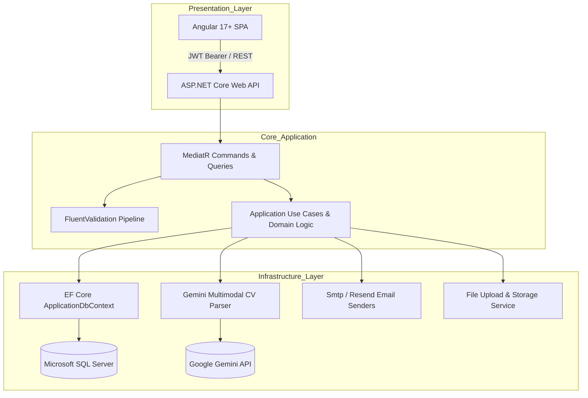

<div align="center">

# ⚡ DevPortfolio & Autonomous AI Resume Studio

### *Enterprise Multi-Tenant Developer Portfolio Platform & AI-Powered Career Schema Engine*

[](https://dotnet.microsoft.com/)
[](https://angular.io/)
[](https://deepmind.google/technologies/gemini/)
[](#-architecture--design-patterns)
[](https://learn.microsoft.com/en-us/ef/core/)
[](LICENSE)

<br/>

<p align="center">
  <b>DevPortfolio</b> is a modern, enterprise-ready developer portfolio platform and career management studio. It combines a high-performance <b>Clean Architecture (.NET 10)</b> backend with a modular <b>Angular 17+ SPA</b>. The platform features an autonomous <b>Gemini Multimodal CV Ingestion Engine</b> that parses PDF resumes into structured domain schemas in-memory, multi-tenant per-user portfolio URLs, two-step OTP verification, role-based access control, real-time analytics, and automated publisher packaging for IIS / MonsterASP deployment.
</p>

[📑 Architecture](#-architecture--design-patterns) • [✨ Key Features](#-key-features) • [🛡️ Security & Hardening](#-security--data-integrity) • [🚀 Setup & Configuration](#-getting-started) • [🌐 Production Deployment](#-production-deployment-guide)

</div>

---

## 📑 Table of Contents

- [✨ Key Features](#-key-features)
- [🏗️ Architecture & Design Patterns](#-architecture--design-patterns)
- [💻 Tech Stack](#-tech-stack)
- [📁 Repository Structure](#-repository-structure)
- [🚀 Setup & Configuration](#-getting-started)
  - [Prerequisites](#prerequisites)
  - [Backend Configuration](#1-backend-configuration)
  - [Frontend Configuration](#2-frontend-configuration)
- [🤖 AI Multimodal CV Ingestion Pipeline](#-ai-multimodal-cv-ingestion-pipeline)
- [🌐 Production Deployment Guide](#-production-deployment-guide)
- [🛡️ Security & Hardening](#-security--data-integrity)
- [🧪 Automated Testing Suite](#-automated-testing-suite)
- [👨‍💻 Author](#-author)

---

## ✨ Key Features

### 🎨 Editorial-Grade Public Portfolio & Multi-Tenant Routing
- **Dual Form Factor UX:** Specialized layouts engineered for ultra-wide workstations (`public-portfolio-desktop`) and touch devices (`public-portfolio-mobile`).
- **Vanity URL Routing:** Dedicated per-developer routes (`/portfolio/{username}` and `/u/{username}`) resolving each engineer's profile, projects, and skills with zero session cross-contamination.
- **Dynamic Theming Engine:** Developer-specific obsidian and dark modern themes stored per profile with automatic fallback.
- **Project Showcase & Tech Stacks:** Filterable repositories, interactive tech chips, architecture tags, and direct demo launch links.
- **Experience & Chronology:** Visual career milestone timeline with tenure calculations, categorized achievements, and verified role badges.

### 🧠 Autonomous AI CV Ingestion Studio
- **Direct PDF Processing:** Stream-based multimodal ingestion powered by **Google Gemini AI** without fragile OCR dependencies.
- **In-Memory Safe Staging:** Extracted nodes (Skills, Projects, Experience, Credentials, Education, Socials) populate directly into the active editor workbench in-memory (`temp-*` IDs).
- **Zero Premature Database Writes:** Engineers review, edit, prune, or add items freely. No changes persist until explicit user confirmation via **"Save Profile Changes"**.
- **Schema Management Workbench:** Full CRUD workbench with in-page confirmation modals, instant avatar upload, drag-and-drop triggers, and real-time schema validation.

### 🔐 Two-Step Authentication & Email OTP Verification
- **Secure Registration Flow:** New accounts undergo two-factor email verification using time-sensitive 6-digit OTP codes.
- **Rate-Limited OTP Resend:** Protected by fixed-window rate limiter policies to prevent abuse and brute-force attempts.
- **Pending Registration Lifecycle:** Automatic expiration and cleanup of unverified registrations.
- **Pluggable Mail Delivery:** Dual-provider architecture supporting SMTP (e.g. Gmail App Passwords) and Resend API.

### 👥 Enterprise Access Control & User Directory
- **Administrative Directory:** Unified console (`/dashboard/access-control`) for listing, filtering, and managing platform users.
- **Role-Based Access Control (RBAC):** Hierarchical permissions across `Admin`, `User`, and `Guest` roles with immediate claim evaluation.
- **Account Security Controls:** Instant account lockout, unlock, and permission toggling via dedicated management services.

### 📬 Interactive Inquiries & Contact Management
- **Targeted Inquiry Submission:** Public contact form automatically routes inquiries to the specific portfolio owner.
- **Submission Rate Limiting:** Hardened with a fixed-window limiter (5 submissions per 15 minutes per IP).
- **Admin Inquiry Inbox:** View inquiry history, toggle read/unread status, search, and delete messages with role validation.

### 📊 Real-Time Analytics & Telemetry Engine
- **Event Tracking Pipeline:** Automated telemetry capturing page impressions, project link clicks, social engagement, and CV downloads.
- **High-Throughput Ingestion:** Rate-limited at 120 events/min per IP to eliminate metric manipulation.
- **Dashboard Summary Cards:** Aggregated real-time metrics displayed on the administrative dashboard overview.

---

## 🏗️ Architecture & Design Patterns

The backend strictly follows **Clean Architecture** and **CQRS (Command Query Responsibility Segregation)** principles:



### Architectural Highlights
- **Domain Layer (`MyPortfolio.Domain`):** Pure enterprise entities (`UserProfile`, `Experience`, `Project`, `SkillCategory`, `Skill`, `Education`, `Certification`, `ContactMessage`, `PendingRegistration`) completely decoupled from persistence mechanisms.
- **Application Layer (`MyPortfolio.Application`):** CQRS handlers orchestrated via `MediatR`, input validation via `FluentValidation`, service interfaces (`IIdentityService`, `IEmailConfirmationService`, `IAdminUserManagementService`), and the unified `Result<T>` pattern.
- **Infrastructure Layer (`MyPortfolio.Infrastructure`):** SQL Server configuration with resilience retries, ASP.NET Core Identity stores, EF Core Migrations, Email services, and AI integration (`GeminiCvParser`).
- **API Layer (`MyPortfolio.API`):** Controllers, custom exception middleware (`GlobalExceptionHandler`), ASP.NET Core RateLimiter policies, HTTP security headers, and Serilog structured telemetry.

---

## 💻 Tech Stack

| Layer | Technologies & Tools |
| :--- | :--- |
| **Frontend** | Angular 17.3, TypeScript 5.4, Vanilla CSS Design System, Tailwind CSS Utilities, Material Symbols, Bootstrap & Devicon Icons |
| **Backend** | .NET 10 / ASP.NET Core Web API, C# |
| **Data & ORM** | Entity Framework Core 10, Microsoft SQL Server, Code-First Migrations |
| **Patterns** | Clean Architecture, CQRS, MediatR, Repository / Unit of Work, Result Pattern |
| **Artificial Intelligence** | Google Gemini Multimodal AI (Structured CV Stream Parsing) |
| **Authentication & RBAC** | ASP.NET Core Identity, JWT Bearer Tokens, Claims-Based & Role-Based Authorization |
| **Security & Throttling** | ASP.NET Core Rate Limiting, HTTP Security Headers Middleware, Protected Document Access |
| **Logging & Docs** | Serilog (Rolling file & console sinks), Swagger / OpenAPI |
| **Hosting & Web Server** | MonsterASP (IIS Windows Shared Hosting) / Kestrel / Azure Ready |

---

## 📁 Repository Structure

```
DevPortfolio/
├── MyPortfolio/
│   ├── Angular/                                  # Frontend Single Page Application
│   │   ├── src/
│   │   │   ├── app/
│   │   │   │   ├── core/                         # Auth, Guards, Interceptors, Services, Models
│   │   │   │   ├── pages/
│   │   │   │   │   ├── public-portfolio-desktop/ # High-Density Workstation View
│   │   │   │   │   ├── public-portfolio-mobile/  # Responsive Mobile View
│   │   │   │   │   ├── cv-import-profile-editor/ # Multimodal CV Ingestion Workbench
│   │   │   │   │   ├── dashboard-overview/       # Analytics & Telemetry Overview
│   │   │   │   │   ├── dashboard-workspace/      # Main Admin Management Studio
│   │   │   │   │   ├── access-control/           # User Directory & Role Management
│   │   │   │   │   ├── projects-repositories/    # Repository & Project Showcase Manager
│   │   │   │   │   ├── skills-experience-manager/# Career Chronology & Skill Matrix
│   │   │   │   │   └── authentication/           # Login, Register, & OTP Verification
│   │   │   │   └── shared/                       # Navbars, Sidebars, Modals, Status Badges
│   │   │   ├── assets/                           # Brand graphics, vendor fonts, and icons
│   │   │   └── web.config                        # IIS SPA URL Rewrite & MIME Types Config
│   │   ├── angular.json
│   │   └── package.json
│   │
│   ├── backend/                                  # .NET Clean Architecture Backend
│   │   ├── src/
│   │   │   ├── MyPortfolio.Domain/               # Enterprise Entities & Value Objects
│   │   │   ├── MyPortfolio.Application/          # CQRS Commands, Queries, DTOs, Validators
│   │   │   ├── MyPortfolio.Infrastructure/       # EF Core, Identity, SQL Server, AI, Email
│   │   │   └── MyPortfolio.API/                  # Controllers, Middlewares, RateLimiters
│   │   ├── tests/
│   │   │   └── MyPortfolio.IntegrationTests/     # Automated Integration & Security Tests
│   │   └── MyPortfolio.sln
│   │
│   └── portfolio-frontend.zip                    # Production-ready compiled publisher archive
├── .gitignore                                    # Multi-layer Git ignore rules
└── README.md                                     # Solution Documentation
```

---

## 🚀 Setup & Configuration

### Prerequisites
- [.NET 10 SDK](https://dotnet.microsoft.com/)
- [Node.js (v18.x or v20.x)](https://nodejs.org/) & `npm`
- [Microsoft SQL Server](https://www.microsoft.com/en-us/sql-server/) (or LocalDB / Azure SQL)
- [Google Gemini API Key](https://aistudio.google.com/)

---

### 1. Backend Configuration

Configuration templates are defined in `appsettings.template.json`. For local development or deployment, configure your `appsettings.Development.json` or `appsettings.json` *(these files are excluded from Git for security)*:

```json
{
  "ConnectionStrings": {
    "DefaultConnection": "Server=YOUR_SERVER;Database=DevPortfolioDb;User Id=YOUR_USER;Password=YOUR_PASSWORD;Encrypt=True;TrustServerCertificate=True;MultipleActiveResultSets=True;"
  },
  "Jwt": {
    "Issuer": "MyPortfolioAPI",
    "Audience": "MyPortfolioClient",
    "Key": "YOUR_CRYPTOGRAPHIC_KEY_MINIMUM_32_BYTES_LONG!",
    "ExpiryInMinutes": 1440
  },
  "Admin": {
    "Email": "admin@yourportfolio.com",
    "Password": "YOUR_ADMIN_PASSWORD"
  },
  "Email": {
    "FrontendBaseUrl": "http://localhost:4200",
    "Smtp": {
      "Host": "smtp.gmail.com",
      "Port": 587,
      "Username": "your-email@gmail.com",
      "Password": "your-app-password",
      "From": "your-email@gmail.com",
      "EnableSsl": true
    }
  },
  "AI": {
    "Provider": "Gemini",
    "Model": "gemini-flash-latest",
    "ApiKey": "YOUR_GEMINI_API_KEY"
  }
}
```

#### Run Database Migrations:
```powershell
dotnet ef database update --project MyPortfolio/backend/src/MyPortfolio.Infrastructure --startup-project MyPortfolio/backend/src/MyPortfolio.API
```

#### Run the API:
```powershell
dotnet run --project MyPortfolio/backend/src/MyPortfolio.API
```
- **API Documentation:** Interactive Swagger UI available at the `/swagger` route.
- **Health Checks:** Status checks available at `/api/health` and `/api/health/db`.

---

### 2. Frontend Configuration

1. **Install Dependencies:**
   ```powershell
   cd MyPortfolio/Angular
   npm install
   ```

2. **Environment Settings:**
   Configure `src/environments/environment.ts` for development or `environment.prod.ts` for production:
   ```typescript
   export const environment = {
     production: false,
     apiUrl: 'http://localhost:5174'
   };
   ```

3. **Start Development Server:**
   ```powershell
   npm start
   ```
   - **Public View:** Access developer portfolios via `/portfolio/{username}` or `/u/{username}`.
   - **Admin Studio:** Access the management workbench via `/dashboard`.

---

## 🤖 AI Multimodal CV Ingestion Pipeline

```
  [ PDF Resume ] ──> ( Magic Byte Check ) ──> [ Gemini AI Stream ] 
                                                      │
                                                      ▼
  [ Database Persist ] <── ( Review & Edit ) <── [ In-Memory Workbench ]
```

1. **Byte-Level Validation:** Incoming file streams are verified against magic header bytes (`%PDF-`) to prevent disguised uploads.
2. **Multimodal Extraction:** The raw PDF stream is submitted directly to **Google Gemini** with structured schema instructions.
3. **Structured Mapping:** The model resolves and categorizes:
   - **Personal Information:** Full Name, Title, Summary, Location, Social Profiles.
   - **Technical Skills:** Categorized into backend, frontend, database, DevOps, and cloud clusters.
   - **Career Timeline:** Roles, companies, tenure, and bulleted achievements.
   - **Projects & Repositories:** Highlights, descriptions, live URLs, and tech stacks.
4. **Zero-Commit Staging:** The data loads locally into the frontend workbench with `temp-*` IDs. The developer can edit, rearrange, or delete any entity.
5. **Atomic Commit:** Clicking **"Save Profile Changes"** synchronizes the updated schema to the database in a single transactional operation.

---

## 🌐 Production Deployment Guide

### Deploying Frontend to MonsterASP / IIS

1. **One-Command Build & Archive:**
   ```powershell
   npm run build:zip
   ```
   This command executes a production Angular build (`ng build --configuration production`) and archives the compiled bundle into `MyPortfolio/portfolio-frontend.zip`.

2. **Upload & Extract:**
   - Upload `portfolio-frontend.zip` directly to the `wwwroot` or root directory on your IIS / MonsterASP web host.
   - Extract all files to the root.

3. **SPA Routing via `web.config`:**
   The bundle includes an enterprise-grade `web.config` that handles HTML5 SPA URL rewrites, static MIME types (including `.woff2` and `.webp`), and security headers:
   ```xml
   <rule name="Angular SPA Routing" stopProcessing="true">
     <match url=".*" />
     <conditions logicalGrouping="MatchAll">
       <add input="{REQUEST_FILENAME}" matchType="IsFile" negate="true" />
       <add input="{REQUEST_FILENAME}" matchType="IsDirectory" negate="true" />
       <add input="{REQUEST_URI}" pattern="^/(api)" negate="true" />
     </conditions>
     <action type="Rewrite" url="/" />
   </rule>
   ```

### Deploying Backend via Visual Studio Web Deploy
The project includes a ready-to-use Web Deploy publish profile (`site98183-WebDeploy.pubxml`). Right-click the `MyPortfolio.API` project in Visual Studio and click **Publish** to deploy directly to your production host.

---

## 🛡️ Security & Data Integrity

- **Restricted Static Document Access:** Direct downloads of uploaded CVs via static file serving (`/uploads/cv`) are strictly intercepted and blocked by custom ASP.NET Core middleware (`403 Forbidden`). All CV downloads are mediated via `/api/portfolio/cv-download`.
- **ASP.NET Core Rate Limiting:** Fixed-window rate limiters protect public endpoints:
  - `public-contact`: 5 requests / 15 minutes
  - `email-confirmation`: 5 requests / 15 minutes
  - `email-resend`: 3 requests / 15 minutes
  - `auth-login`: 10 requests / 15 minutes
  - `analytics-events`: 120 events / 1 minute
- **HTTP Security Headers Middleware:** Responses automatically include `X-Content-Type-Options: nosniff`, `X-Frame-Options: SAMEORIGIN`, `Referrer-Policy: strict-origin-when-cross-origin`, and `Permissions-Policy`.
- **JWT Cryptographic Integrity:** Minimum 32-byte signing key validation enforced at application startup.
- **Data Protection in Version Control:** All sensitive setting files (`appsettings.json`, `appsettings.Development.json`, and secrets) are permanently ignored in `.gitignore`.

---

## 🧪 Automated Testing Suite

The backend contains automated integration and authorization tests built with **xUnit** and **Microsoft.AspNetCore.Mvc.Testing**:

- **Authorization Pipeline Tests:** Verify anonymous submission allowances, token validation, user boundaries, and guest restrictions.
- **Multi-Tenant Ownership Tests:** Verify that public vanity URLs (`/portfolio/{username}`) resolve the exact owner regardless of current authentication context.

Run the test suite:
```powershell
dotnet test MyPortfolio/backend
```
```text
Passed!  - Failed: 0, Passed: 12, Skipped: 0, Total: 12
```

---

## 👨‍💻 Author

**Abdallah Abd-ElTawab**  
*Full-Stack .NET & Angular Software Engineer*

- **GitHub:** [@Abdallah72296](https://github.com/Abdallah72296)
- **Repository:** [DevPortfolio](https://github.com/Abdallah72296/DevPortfolio)

---

<div align="center">
  <sub>Built with ❤️ using Clean Architecture, .NET 10, Angular 17, and Google Gemini AI.</sub>
</div>
