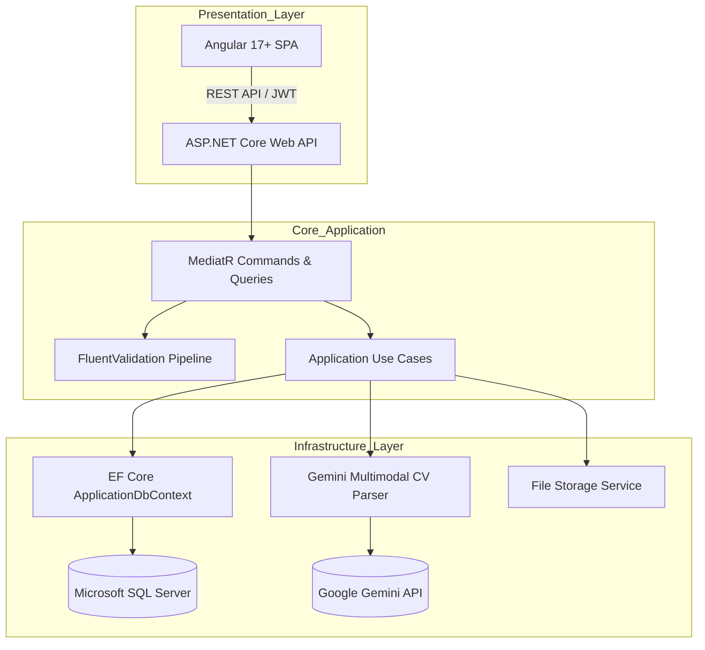

<div align="center">

# ⚡ DevPortfolio & AI Schema Engine

### *Enterprise Developer Portfolio & Autonomous AI-Powered Resume Ingestion Studio*

[](https://dotnet.microsoft.com/)
[](https://angular.io/)
[](https://deepmind.google/technologies/gemini/)
[](#-architecture--design-patterns)
[](https://learn.microsoft.com/en-us/ef/core/)
[](LICENSE)

<br/>

<p align="center">
  <b>DevPortfolio</b> is a state-of-the-art developer portfolio platform paired with a granular administrative studio. It features an automated <b>Gemini Multimodal CV Parser</b> that ingests PDF resumes directly into memory, maps complex engineering nodes (Skills, Projects, Roles, Education, Certifications), and allows real-time review and editing before committing changes to production.
</p>

[🌟 Live Demo](https://alexrivera.devfolio.io) • [📑 Documentation](#-table-of-contents) • [🚀 Quick Start](#-getting-started) • [🏗️ Architecture](#-architecture--design-patterns)

</div>

---

## 📑 Table of Contents

- [✨ Key Features](#-key-features)
- [🏗️ Architecture & Design Patterns](#-architecture--design-patterns)
- [💻 Tech Stack](#-tech-stack)
- [📁 Repository Structure](#-repository-structure)
- [🚀 Getting Started](#-getting-started)
  - [Prerequisites](#prerequisites)
  - [Backend Setup](#1-backend-setup)
  - [Frontend Setup](#2-frontend-setup)
- [🤖 AI Multimodal CV Ingestion Pipeline](#-ai-multimodal-cv-ingestion-pipeline)
- [🌐 Production Deployment Guide](#-production-deployment-guide)
- [🛡️ Security & Data Integrity](#-security--data-integrity)
- [👨‍💻 Author & Contributions](#-author)

---

## ✨ Key Features

### 🎨 Editorial-Grade Public Portfolio
- **Dual Form Factor UX:** Specialized layouts optimized for both ultra-wide engineering workstations (`public-portfolio-desktop`) and mobile devices (`public-portfolio-mobile`).
- **Telemetry & Live Status Strips:** Real-time visual signals for zero-latency sync, production node verification, and customizable metric counters.
- **Project Showcase:** Interactive project cards with technology chips, GitHub repositories, and live demo launch links.
- **Categorized Tech Stack:** Rich iconography for backend, database, messaging, and cloud tooling with automated SVG fallback resolution.
- **Experience Timeline:** Detailed engineering chronology with role badges, tenure calculations, and achievements.

### 🧠 Multimodal AI CV AutoComplete Studio
- **Direct PDF Processing:** Stream-based document ingestion powered by **Gemini 2.5 Flash** without third-party OCR wrappers.
- **In-Memory Safe Inspection:** Extracted nodes (Personal details, Categorized Skills, Experiences, Projects, Credentials, Social Links) populate directly into the active editor workbench in-memory (`temp-*` IDs).
- **Zero Premature Writes:** Review, prune, edit, or add items freely. No changes hit the database until explicit user approval via **"Save Profile Changes"**.
- **Granular Schema Editor:** Full CRUD workbench with in-page confirmation modals, instant avatar upload, drag-and-drop triggers, and real-time validation.

---

## 🏗️ Architecture & Design Patterns

The backend follows strictly the **Clean Architecture** and **CQRS (Command Query Responsibility Segregation)** principles:



### Architectural Highlights
- **Domain Layer (`MyPortfolio.Domain`):** Pure enterprise entities (`Profile`, `Experience`, `Project`, `SkillCategory`, `Skill`, `Education`, `Certification`, `SocialLink`) isolated from database frameworks.
- **Application Layer (`MyPortfolio.Application`):** CQRS handlers orchestrated via `MediatR`, request validation via `FluentValidation`, and declarative interfaces.
- **Infrastructure Layer (`MyPortfolio.Infrastructure`):** EF Core configurations, SQL Server persistence, Identity stores, and AI implementations (`GeminiCvParser`).
- **API Layer (`MyPortfolio.API`):** Controllers, custom exception middleware, JWT Bearer security, Serilog telemetry, and Swagger documentation.

---

## 💻 Tech Stack

| Layer | Technologies & Tools |
| :--- | :--- |
| **Frontend** | Angular 17+, TypeScript, Vanilla CSS Tokens, Modern Tailwind Utilities, Material Symbols |
| **Backend** | .NET 10 / ASP.NET Core Web API, C# |
| **Data & ORM** | Entity Framework Core, Microsoft SQL Server, Code-First Migrations |
| **Patterns** | Clean Architecture, CQRS, MediatR, Repository/UnitOfWork, Result Pattern |
| **Artificial Intelligence**| Google Gemini 2.5 Flash (Multimodal Ingestion & Structured Parsing) |
| **Authentication** | ASP.NET Core Identity, JWT Bearer Tokens, Role-Based Access Control |
| **Logging & Docs** | Serilog (Rolling file & console), Swagger / OpenAPI |
| **Hosting & Web Server** | MonsterASP (IIS Windows Shared Hosting) / Kestrel / Azure Ready |

---

## 📁 Repository Structure

```
DevPortfolio/
├── MyPortfolio/
│   ├── Angular/                          # Frontend SPA Application
│   │   ├── src/
│   │   │   ├── app/
│   │   │   │   ├── core/                 # Auth, Services, Interceptors, Models
│   │   │   │   ├── pages/
│   │   │   │   │   ├── public-portfolio-desktop/   # Workstation Editorial View
│   │   │   │   │   ├── public-portfolio-mobile/    # Touch-Optimized Mobile View
│   │   │   │   │   ├── cv-import-profile-editor/   # Studio Schema Workbench
│   │   │   │   │   └── authentication/             # JWT Studio Login
│   │   │   │   └── shared/               # Reusable telemetry, headers, modals
│   │   │   └── web.config                # IIS URL rewrite rules for SPA routing
│   │   └── package.json
│   │
│   ├── backend/                          # .NET Clean Architecture Solution
│   │   ├── src/
│   │   │   ├── MyPortfolio.Domain/       # Core Domain Entities & Value Objects
│   │   │   ├── MyPortfolio.Application/  # MediatR Commands, Queries, Validators
│   │   │   ├── MyPortfolio.Infrastructure/ # EF Core, Gemini Parser, Identity
│   │   │   └── MyPortfolio.API/          # Controllers, Program.cs, Middleware
│   │   └── MyPortfolio.sln
│   │
│   └── portfolio-frontend.zip            # Production-ready compiled bundle
└── README.md                             # Repository Master Documentation
```

---

## 🚀 Getting Started

### Prerequisites
- [.NET 10 SDK](https://dotnet.microsoft.com/)
- [Node.js (v18.x or v20.x)](https://nodejs.org/) & `npm`
- [Microsoft SQL Server](https://www.microsoft.com/en-us/sql-server/) (or SQL Server Express / LocalDB)
- [Google Gemini API Key](https://aistudio.google.com/)

---

### 1. Backend Setup

1. **Navigate to the API folder:**
   ```powershell
   cd MyPortfolio/backend/src/MyPortfolio.API
   ```

2. **Configure `appsettings.json`:**
   ```json
   {
     "ConnectionStrings": {
       "DefaultConnection": "Server=localhost;Database=DevPortfolioDb;Trusted_Connection=True;TrustServerCertificate=True;"
     },
     "Gemini": {
       "ApiKey": "YOUR_GEMINI_API_KEY",
       "Model": "gemini-2.5-flash"
     },
     "Jwt": {
       "Secret": "YOUR_SUPER_SECRET_KEY_MINIMUM_32_CHARACTERS_LONG",
       "Issuer": "MyPortfolio",
       "Audience": "MyPortfolioClient",
       "ExpiryMinutes": 1440
     }
   }
   ```

3. **Apply Database Migrations:**
   ```powershell
   dotnet ef database update --project ../MyPortfolio.Infrastructure/MyPortfolio.Infrastructure.csproj --startup-project MyPortfolio.API.csproj
   ```

4. **Run the Backend:**
   ```powershell
   dotnet run
   ```
   - Swagger Documentation: `http://localhost:5174/swagger`
   - Health Check: `http://localhost:5174/api/health`

---

### 2. Frontend Setup

1. **Navigate to the Angular folder:**
   ```powershell
   cd MyPortfolio/Angular
   ```

2. **Install Dependencies:**
   ```powershell
   npm install
   ```

3. **Verify Environment Config:**
   Update `src/environments/environment.ts` with your API base URL:
   ```typescript
   export const environment = {
     production: false,
     apiBaseUrl: 'http://localhost:5174/api'
   };
   ```

4. **Start the Development Server:**
   ```powershell
   npm start
   ```
   - Application URL: `http://localhost:4200/portfolio`
   - Studio Dashboard: `http://localhost:4200/dashboard`

---

## 🤖 AI Multimodal CV Ingestion Pipeline

1. **File Stream Ingestion:**
   User drops a PDF resume into the CV Import zone. Magic bytes (`%PDF-`) are verified at the byte level before reading.
2. **Gemini 2.5 Flash Processing:**
   The PDF binary stream is transmitted to Gemini via structured JSON schema instructions.
3. **Structured Entity Resolution:**
   The model strictly separates:
   - **`jobTitle`:** Concise engineering role (e.g., *.NET Backend Developer*).
   - **`about`:** Executive Summary / Technical Bio.
   - **`skills`:** Categorized engineering clusters (Backend, Database, Messaging, Cloud).
   - **`experiences`:** Chronological positions with dates and achievements.
   - **`projects`:** Tech stack lists, repositories, and descriptions.
4. **Interactive In-Memory Staging:**
   The frontend populates all records locally with `temp-*` IDs. The engineer reviews, edits, or deletes records.
5. **Transactional Hot Deployment:**
   Pressing **"Save Profile Changes"** atomically creates and replaces portfolio records in the database.

---

## 🌐 Production Deployment Guide

### Deploying Frontend to MonsterASP (IIS)
1. Build the production Angular bundle:
   ```powershell
   npm run build
   ```
2. The compilation artifacts are placed in `dist/portfolio-app/browser` alongside `web.config`.
3. Use the pre-packed zip archive [portfolio-frontend.zip](portfolio-frontend.zip) and upload directly via MonsterASP File Manager or FTP to the website root.
4. IIS will automatically process Angular routes via the bundled URL Rewrite rule:
   ```xml
   <rule name="Angular Routes" stopProcessing="true">
     <match url=".*" />
     <conditions logicalGrouping="MatchAll">
       <add input="{REQUEST_FILENAME}" matchType="IsFile" negate="true" />
       <add input="{REQUEST_FILENAME}" matchType="IsDirectory" negate="true" />
     </conditions>
     <action type="Rewrite" url="/" />
   </rule>
   ```

---

## 🛡️ Security & Data Integrity

- **Strict Binary Validation:** PDF file streams are checked for magic header bytes `%PDF-` to prevent disguised MIME upload vulnerabilities.
- **JWT Authentication:** Stateful user session replacement with cryptographically signed tokens.
- **Audit & Friendly Error Handling:** Error responses sanitize internal exception stack traces before client presentation.
- **SQL Injection Prevention:** 100% parameterization via Entity Framework Core query pipelines.

---

## 👨‍💻 Author

**Abdallah Abd-ElTawab**  
*Senior .NET Backend Developer & Systems Engineer*  

- **Portfolio:** [https://alexrivera.devfolio.io](https://alexrivera.devfolio.io)
- **GitHub:** [@Abdallah72296](https://github.com/Abdallah72296)
- **Repository:** [DevPortfolio](https://github.com/Abdallah72296/DevPortfolio)

---

<div align="center">
  <sub>Built with ❤️ using Clean Architecture, .NET 10, Angular 17, and Google Gemini AI.</sub>
</div>
